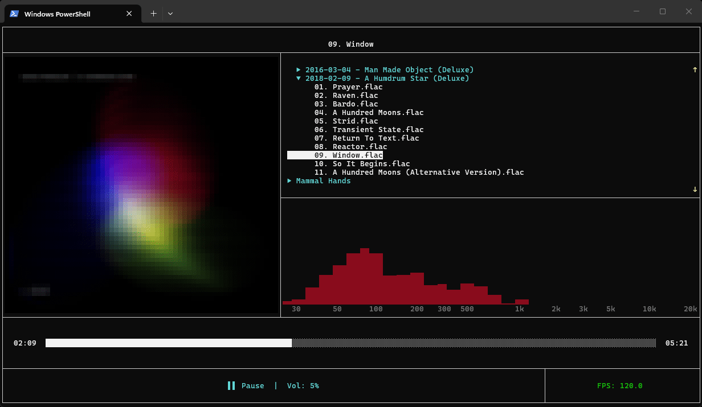
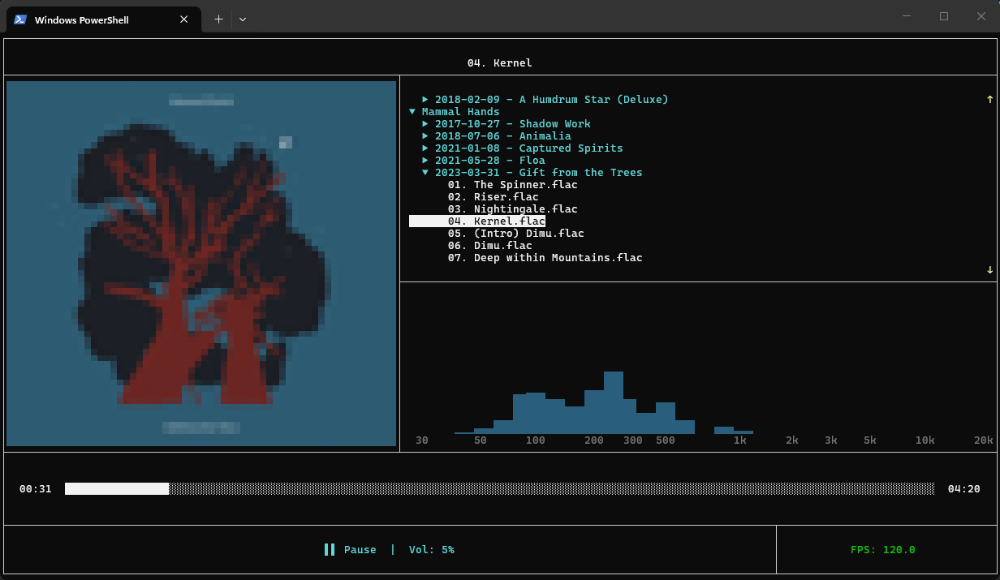

# tui-player

A local music player that runs in the terminal, written in Rust. It shows a file browser, album art, a live spectrum visualiser and a progress bar!



## Highlights

- **Cross-platform.** Built on [crossterm](https://github.com/crossterm-rs/crossterm) for the terminal and [cpal](https://github.com/RustAudio/cpal) for audio, both of which support Windows, macOS and Linux.
- **Many formats.** FLAC, MP3, Ogg Vorbis, Opus and WAV, resampled to the output device's rate with [rubato](https://github.com/HEnquist/rubato).
- **Event-driven UI.** Widgets subscribe to the state keys they care about (publish/subscribe) and redraw only when something they show has changed.
- **Fast rendering.** Each frame sends the terminal only the cells that changed since the last one, so a frame where just the progress bar moves costs microseconds.
- **Object-oriented widgets.** Every panel implements one `Widget` trait, dispatched statically with `enum_dispatch` rather than through trait objects.
- **Layout tree.** The screen is a tree of row and column splits. Neighbouring panels share borders exactly, and you can drag any divider to resize the panels on either side.

- **Isolated drawing.** Each widget draws through a canvas that covers only its own area, so it can't overwrite another panel.
- **Visuals in plain text.** Album art is drawn with coloured half-block characters (two pixels per cell), and the spectrum is a 4096-point FFT computed on its own thread.

## Running

```sh
cargo run --release
```

The music folder is currently set in `src/main.rs` (`FileList::new(...)`).

| Key | Action |
|---|---|
| `↑` `↓` / `j` `k` | Move through the file list |
| `Enter` | Open a folder, or choose an action for a track |
| `Space` | Play / pause |
| `+` / `-` | Volume |
| `Esc` | Close the menu |
| `q` | Quit |
| Mouse | Click to select, scroll the list, drag a border to resize |